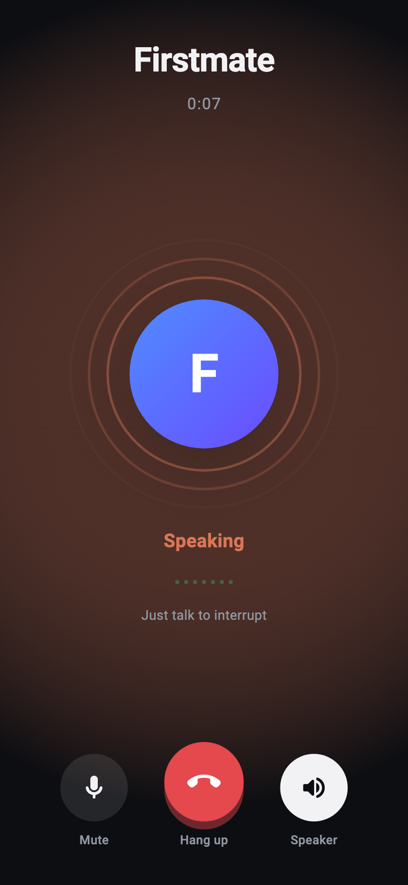
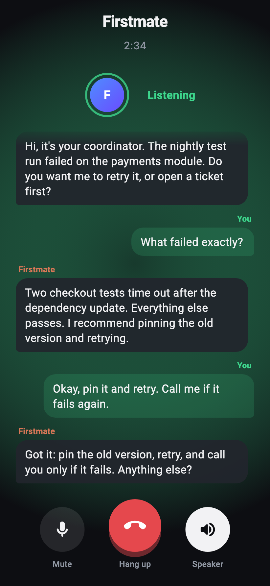
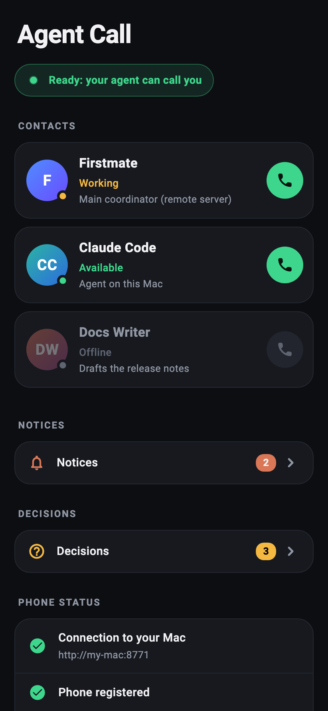
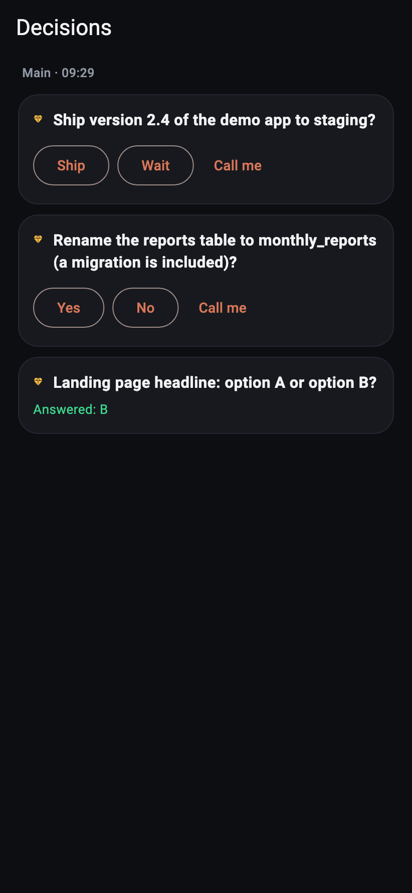
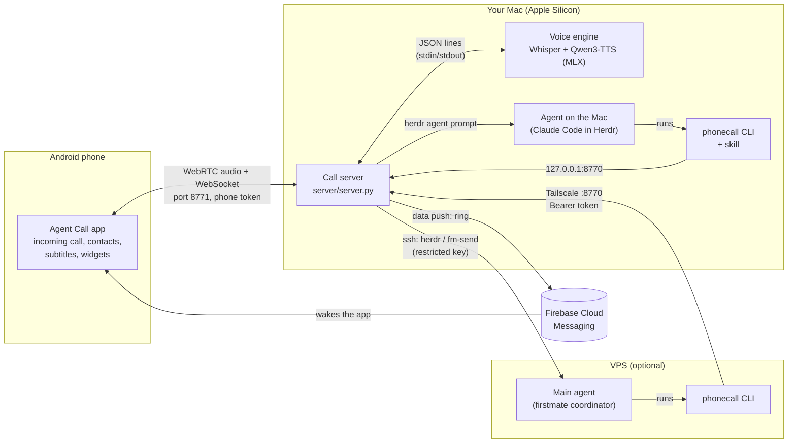
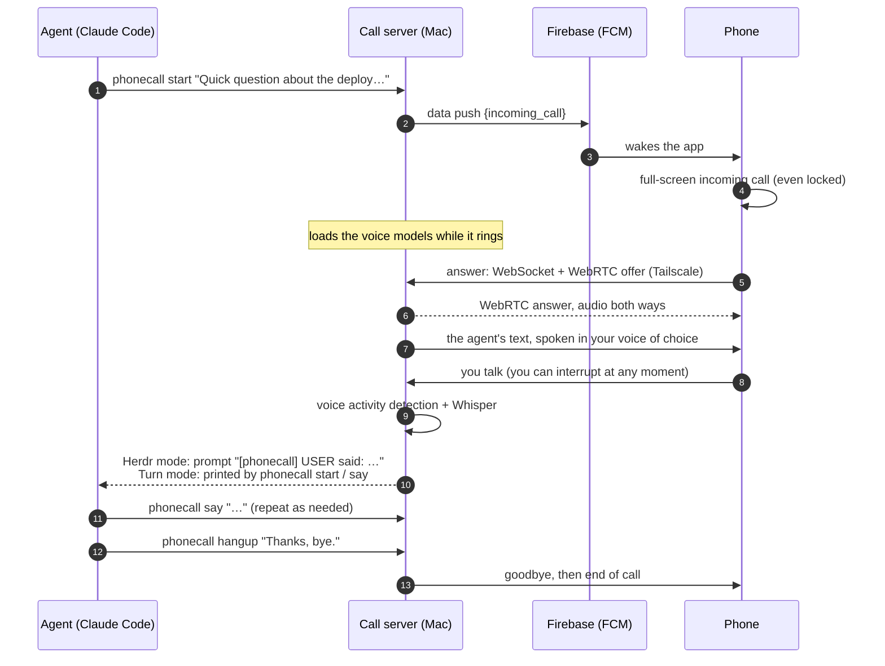
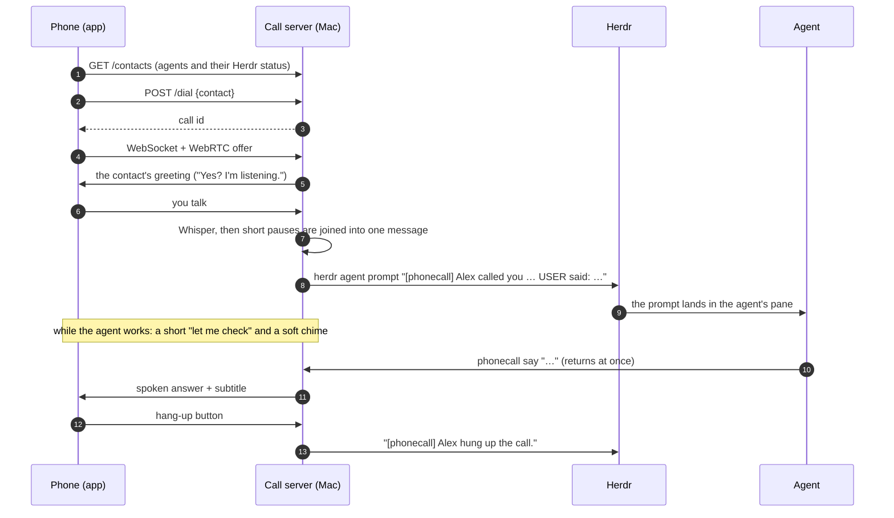
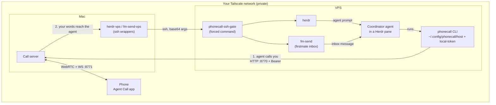

# agent-phone-call: phone calls between you and your AI agent

Your coding agent (Claude Code, a firstmate coordinator, any agent that can run a shell command)
**calls your Android phone and talks with you by voice**, and you can **call it back** and keep talking,
for as long as you like. Speech recognition and the voice run **on your own Mac**; the call travels
over your **private network**.

<p align="center">
  
  
  
  
</p>
<p align="center"><sub>Screens of the Android app, rendered from the app's own widgets with made-up data
(<a href="app/tool/screenshots_test.dart">app/tool/screenshots_test.dart</a>).</sub></p>

> **What it costs: only the plan your agent already uses (for example a Claude subscription).
> Nothing else is billed.**
> Speech-to-text and text-to-speech run locally, so you can talk for hours without paying per minute,
> per token of audio or per call. There is no phone number to buy and no telephony provider
> (no Twilio, no SIP trunk): the call goes through the app in this repository.

**Install it:** follow [SETUP.md](SETUP.md). It is written so that a coding agent such as Claude Code can
follow it from start to finish on its own, and it says exactly where a human has to step in.

## Use cases

**1. Your agent calls you when it needs you.** It is in the middle of a task and needs a decision,
an approval or a fact only you have, and you are away from the computer. Your phone rings
full-screen (even locked); the agent explains, you answer by voice, it hangs up and carries on.

**2. You call your agent and talk with it.** Open the app, tap the agent (for example your main
firstmate coordinator) and talk: ask for status, give instructions, think out loud. You can
interrupt it at any moment, the way you would interrupt a person.

## What it costs, honestly

| Piece | Needed? | Cost |
|---|---|---|
| Your agent's plan (e.g. a Claude subscription) | yes | what you already pay; calls use it like any other prompt |
| Speech-to-text: Whisper large-v3-turbo on your Mac (MLX) | yes (or your own, see below) | free, local |
| Text-to-speech: Qwen3-TTS 1.7B on your Mac (MLX) | yes (or your own, see below) | free, local |
| Tailscale (private network between phone, Mac and VPS) | yes | the free Personal plan is enough |
| Firebase Cloud Messaging (wakes the phone to ring) | yes | free (Spark plan); FCM itself has no charge |
| Jev by typesafe.ai (instant, fitting acknowledgements) | **optional, off by default** | your own key; check typesafe.ai for its pricing |
| Hermes (hermes-agent) for the «Talk» widget | optional | whatever that agent's model costs you |
| A cloud speech API instead of the local models | optional | billed by that provider; a local server costs nothing |

Everything optional is off until you turn it on. The only exception to "nothing else is billed" is a
paid option you choose yourself.

## Why a custom Android app

A phone call from an agent usually means a telephony provider: buy a number, pay per minute,
send your audio through a third party. This project avoids all of that. The Android app in
[`app/`](app) receives a silent push (FCM) that makes it ring like a real incoming call
(full screen, even when locked), and the audio flows over **WebRTC directly between the phone and
your Mac, inside your Tailscale network**. The only running cost stays your agent's subscription,
and your voice never goes to a call provider.

## How it works



| Piece | Where | What it does |
|---|---|---|
| **Call server** ([`server/server.py`](server/server.py)) | Mac | Rings the phone through FCM, runs the WebRTC call (aiortc), detects when you speak (Silero VAD), lets you interrupt (barge-in), plays short recorded acknowledgements while the agent thinks, and hands your words to the agent. |
| **Voice engine** ([`server/engine.py`](server/engine.py)) | Mac | A subprocess that keeps the speech models loaded only while calls happen (and 10 minutes after), then frees the memory. Swappable (see [Speech](#speech-stt-and-tts)). |
| **`phonecall` CLI** ([`server/phonecall.py`](server/phonecall.py)) | Mac or VPS | What the agent runs: `phonecall start "…"`, `phonecall say "…"`, `phonecall hangup "…"`, `phonecall status`. It calls the server's `/start`, `/say`, `/end` and `/status`. Standard library only. |
| **Skill** ([`skills/phonecall/SKILL.md`](skills/phonecall/SKILL.md)) | wherever the agent runs | Teaches a Claude Code agent when and how to call (only when blocked on you, how to speak, what the exit codes mean). |
| **Android app** ([`app/`](app)) | phone | Flutter. Incoming-call screen, contacts you can call, live subtitles, notices, decisions, and optional home-screen widgets (decisions, fleet status, talk by voice). |
| **Remote bridge** ([`remote/`](remote)) | Mac and VPS | Lets the Mac reach an agent on a VPS through Herdr, over ssh with a key that can run nothing else. |

Two ways the agent hears you:

- **Turn mode** (any agent): `phonecall say "…"` blocks until you answer and prints your words.
- **Herdr mode** (the agent runs inside a [Herdr](https://herdr.dev) pane, a terminal workspace for agents):
  your words arrive as prompts `[phonecall] USER said: …` and `phonecall say` returns at once. This is also
  what lets **you** call an agent: the server types your words into its pane (or sends them to its
  firstmate inbox with `fm-send`).

### The agent calls you



### You call the agent



### A coordinator on another machine, through Herdr

A main agent on a VPS (for example a firstmate coordinator running in Herdr) can call you, and you can
call it. Everything travels inside your Tailscale network: the phone and the VPS only ever talk to the
Mac, and the Mac reaches the VPS with an ssh key that can run nothing but `herdr` and `fm-send`.



Step 10 and step 11 of [SETUP.md](SETUP.md) set this up.

## Install

[SETUP.md](SETUP.md) is the step-by-step installer: requirements, numbered steps with exact commands, a check
after each step, the moments a human must act (installing the app, Firebase, the Tailscale login,
microphone permissions), the configuration files, and an end-to-end test in both directions.
You can hand it to Claude Code as is:

```text
Follow SETUP.md in this repository to install agent-phone-call on this Mac. Stop and ask me
whenever a step says a human has to act.
```

In short, you need: a Mac with Apple Silicon (16 GB RAM recommended), [Homebrew](https://brew.sh), an
Android phone (Android 8+), a free [Tailscale](https://tailscale.com) account, a free
[Firebase](https://firebase.google.com) project, and [Flutter](https://docs.flutter.dev/get-started/install)
(stable) with the Android SDK to build the app.

## Configuration

`~/.config/phonecall/config.json` (started from [`examples/config.json.example`](examples/config.json.example)):

| Key | Meaning |
|---|---|
| `phone_token` | Long random secret shared with the app (`openssl rand -hex 32`). |
| `phone_host`, `phone_port` | Where the phone API listens: the Mac's **Tailscale IP**, port 8771. |
| `local_port` | Local API for the `phonecall` CLI on this Mac (always `127.0.0.1`), 8770. |
| `agent_host` | Optional: the Mac's Tailscale IP, to let agents on other machines call (same port, Bearer token). |
| `service_account` | Path to the Firebase service-account key. |
| `contacts` | The agents the app can call: `id`, `name`, `subtitle`, `agent` (Herdr agent/pane id), optional `inbox` (send through `fm-send` instead of typing in the pane), optional `herdr_bin` (e.g. `~/.local/bin/herdr-vps` for an agent on the VPS), optional `greeting` (what it says when you call). A contact with `"id": "firstmate"` also receives the text channel (`/text/send`, the «Talk» widget). |

Files in `~/.config/phonecall/` (a file's presence switches a feature on, checked live, no restart):

| File | Effect |
|---|---|
| `stream-tts` | Stream the voice as it is generated (first sound in ~0.7 s instead of after the whole phrase). Recommended. |
| `nod-on` | Soft nods ("uh-huh", "mm") while you talk for a long time (with headphones). `nod-speaker` allows them on speaker too. |
| `jev-on` + `jev-token` | Turn Jev on (see below) with your own typesafe.ai key. |
| `local-token` | The Bearer token of the agent API (only with `agent_host`). |
| `fillers/`, `waiting/`, `greetings/` | Recorded acknowledgements and contact greetings (written by `make_fillers.py` and by the server). |
| `device.json` | Written by the server when the app registers (the phone's FCM token). |

Environment variables of the server (set them in the launchd plist,
[`examples/phonecall.server.plist.example`](examples/phonecall.server.plist.example)):

| Variable | Default | Meaning |
|---|---|---|
| `PHONECALL_NAME` | `Your user` | Your name as the agent reads it: `[phonecall] Alex called you on the phone…` |
| `PHONECALL_LANGUAGE` | `en` | The language you speak on calls: `en` or `es` (see [Language](#language)). |
| `PHONECALL_CONFIG` | `~/.config/phonecall` | Configuration folder. |
| `PHONECALL_ENGINE`, `PHONECALL_ENGINE_PYTHON` | `engine.py`, root `.venv` | Swap the voice engine (see below). |
| `PHONECALL_VOICE` | `voices/my-voice/voice.json` | The TTS voice. |
| `PHONECALL_WHISPER` | `mlx-community/whisper-large-v3-turbo` | Any MLX Whisper model. |
| `PHONECALL_WHISPER_PROMPT` | from the language pack | Vocabulary hint for Whisper (names, project words). |
| `PHONECALL_WARM_SECONDS` | `600` | How long models stay loaded after a call or after the app opens. |
| `PHONECALL_FM_SEND` | `~/.local/bin/fm-send-vps` | Command used for contacts with an `inbox`. |
| `PHONECALL_FM_HOME`, `PHONECALL_HERMES*` | | Optional widget extras (firstmate notes, Hermes). |
| `PHONECALL_RECORD` | off | `1` saves the phone's audio to disk for debugging. Leave it off. |

The `phonecall` CLI reads `PHONECALL_HOST` / `PHONECALL_TOKEN` / `PHONECALL_PORT`, or the files
`~/.config/phonecall/host` and `~/.config/phonecall/local-token` (see SETUP.md, step 10).

## Language

Everything in this repository (code, prompts to the agent, the app) is in English. The conversation
itself happens in the language you set with `PHONECALL_LANGUAGE`: it tells Whisper what to transcribe,
which words mean you are not done talking, the default greeting and the short phrases
`make_fillers.py` records. Two packs ship in [`server/language.py`](server/language.py): `en` (default)
and `es`. The agent is told which language to speak back. To add another language, copy a pack,
translate its phrases and re-run `make_fillers.py`; set the voice's `language` in `voice.json` too.

## Speech: STT and TTS

### What it uses by default

- **STT: Whisper large-v3-turbo** through [mlx-whisper](https://github.com/ml-explore/mlx-examples),
  locally on the Mac's GPU. Phone audio is cut into turns by **Silero VAD** (ONNX, included, 2 MB) and each
  turn is transcribed as soon as you stop. Known Whisper hallucinations on silence ("Thanks for watching",
  "Subtitles by…") are dropped.
- **TTS: Qwen3-TTS 1.7B Base (bf16)** through [mlx-audio](https://github.com/Blaizzy/mlx-audio),
  locally, cloning the voice from a reference clip you provide, streamed in ~1 s chunks, 48 kHz.
- **Acknowledgement clips** (`make_fillers.py`): short phrases recorded once in the same voice and
  played instantly ("Mm, okay.", "Let me check.", a soft signal while the agent keeps working), so the
  line is never dead while the agent thinks.
- **Jev (optional, typesafe.ai, your own key)**: a very fast classifier asked within 0.4 s. As soon as you
  stop talking it picks the acknowledgement that fits what you said (a question gets "Let me check", an
  order "Okay, on it", a thanks "You're welcome"), and when you speak over the agent it tells a real
  interruption ("wait, no") from a mere "uh-huh" so the agent keeps talking. Without Jev, a neutral
  acknowledgement plays and any speech over the agent interrupts it.
  On with `~/.config/phonecall/jev-on` plus your key in `~/.config/phonecall/jev-token`.

### Use your own model, or an existing one

The server never imports a model. It talks to a **voice engine subprocess** over a tiny JSON-lines
protocol on stdin/stdout, documented at the top of [`server/engine.py`](server/engine.py):

```
{"id": 1, "op": "stt", "pcm": "/tmp/x.pcm"}                  -> {"id": 1, "ok": true, "text": "..."}
{"id": 2, "op": "tts", "text": "Hello.", "out": "/tmp/y.wav"} -> {"id": 2, "ok": true, "out": "/tmp/y.wav"}
{"id": 3, "op": "tts_stream", "text": "Hello.", "out": "/tmp/z"} -> {"id": 3, "ok": true, "chunk": "/tmp/z.0.pcm"} … {"id": 3, "ok": true, "final": true}
```

(STT input: raw 16 kHz mono int16. TTS output: 48 kHz mono 16-bit, WAV or raw chunks.) Three levels of change:

1. **Another MLX Whisper or another cloned voice**: just settings: `PHONECALL_WHISPER`,
   `PHONECALL_LANGUAGE`, `PHONECALL_VOICE`.
2. **Any OpenAI-compatible speech API, local or cloud**: use the included
   [`server/engine_openai.py`](server/engine_openai.py) (standard library + ffmpeg):

   ```
   PHONECALL_ENGINE=/PATH/TO/REPO/server/engine_openai.py
   PHONECALL_ENGINE_PYTHON=/PATH/TO/REPO/server/.venv/bin/python
   PHONECALL_API_BASE=http://127.0.0.1:8000/v1     # a local server: speaches, LocalAI, Kokoro-FastAPI…
   PHONECALL_STT_MODEL=…  PHONECALL_TTS_MODEL=…  PHONECALL_TTS_VOICE=…  PHONECALL_API_KEY=… (if needed)
   ```

   Pointed at a local server it stays free; pointed at a cloud API (OpenAI, Groq…) each request is billed
   by that provider.
3. **Your own model**: write a script that speaks the protocol above (copy `engine_openai.py` and
   replace `transcribe()` and `_speech()`), and point `PHONECALL_ENGINE` / `PHONECALL_ENGINE_PYTHON` at it.
   The server needs nothing else.

## Security

The server is **not designed to be exposed to the internet**. Use it only inside a private network
such as Tailscale.

- Do **not** open ports on your router or set up port forwarding to the Mac, and do not bind
  `phone_host` / `agent_host` to `0.0.0.0` or a public address: use the Mac's Tailscale IP.
  The local API is always `127.0.0.1` only.
- The phone API requires `phone_token`; the agent API requires `Authorization: Bearer <local-token>`.
  Make both long and random (`openssl rand -hex 32`), keep them in files with `chmod 600`, and never
  commit or paste them anywhere. If one leaks, generate a new one, update `config.json` /
  `local-token` (and rebuild the app or copy the token to the VPS), and restart the server.
- The phone token is compiled into the APK: do not share your APK.
- Restrict the tailnet with **Tailscale ACLs**: only your phone and your VPS need to reach the Mac on
  ports 8771 and 8770.
- The ssh key the Mac uses to reach the VPS is limited to `phonecall-ssh-gate` (only `herdr` and `fm-send`,
  no shell, no forwarding). Keep `StrictHostKeyChecking=yes`.
- Keep `service-account.json`, `google-services.json`, `jev-token`, `device.json` and your voice
  recordings out of git (the `.gitignore` already does).
- A call gives your voice direct access to an agent that can run commands. The skill tells the agent to
  repeat back anything important or destructive and wait for a yes; keep that rule.

## HTTP API and CLI

| Port | Who | Routes |
|---|---|---|
| `127.0.0.1:8770` (local) | `phonecall` CLI, local helpers | `POST /start /say /end`, `GET /status`, `POST /dictate /speak /jev /jev/warm /text/send`, `GET /text/reply` |
| `<tailscale>:8770` (agent, Bearer) | agents on other machines | the same, plus `GET /fcm-token` |
| `<tailscale>:8771` (phone, token) | the app | `POST /register /decline /dial /dictate /speak /talk`, `GET /contacts /call /ws /ping /fleet /reply` |

`phonecall` exit codes: `0` answered · `6` you interrupted the agent · `7` you spoke while it was thinking
(its text was not said) · `3` no answer or declined · `4` you hung up · `5` silence · `1` error.

**Notifications from a remote agent (optional).** The app also shows FCM data messages an agent sends
itself, using its own copy of the service account and the phone's FCM token it reads from the Mac's agent
API (`GET /fcm-token`, Bearer):

- `{"type": "notice", "id", "category": summary|meeting|email|decision|health, "title", "body", "urgent": "0"|"1"}`:
  a notification, kept in the app's «Notices» inbox.
- `{"type": "tasks", "generated": ISO-8601, "tasks": "<JSON: {running: [...], waiting: [...], queued: [...]}>"}`:
  feeds the «Decisions» section and the «Decisions» and «Fleet» widgets; `waiting` items may be
  `{id, title, detail, options}` and are answered from the app or the widget through the server's `/talk`
  (`[widget-decision] id=… answer=…` or `[widget-callme] id=…`, sent to the `firstmate` contact).

## Repository layout

```
README.md  SETUP.md  LICENSE
install.sh                       installer: the Mac (default) or a remote agent machine (--remote)
requirements-engine.txt          voice engine deps (MLX, mlx-whisper, mlx-audio), repository root .venv
docs/images/                     app screenshots (rendered by app/tool/screenshots_test.dart)
examples/
  config.json.example            ~/.config/phonecall/config.json
  phonecall.server.plist.example launchd service for the server
remote/
  herdr-vps.example              Mac → VPS: run herdr there over a restricted ssh key
  fm-send-vps.example            Mac → VPS: run fm-send there over the same key
  phonecall-ssh-gate             VPS: forced command of that key (only herdr / fm-send)
skills/phonecall/SKILL.md        the skill for Claude Code
voices/
  README.md                      how to make the voice
  my-voice/voice.json.example
server/                          call server, CLI, voice engines, tests
  server.py  phonecall.py  engine.py  engine_openai.py  language.py  vad.py  push.py  jev.py
  herdr_agent.py  make_fillers.py  fleet_snapshot.py  models/silero_vad.onnx
  test_server.py  test_engine_openai.py  requirements.txt
app/                             Flutter Android app («Agent Call»)
  lib/  test/  tool/screenshots_test.dart  android/
```

## Tests

```sh
cd server
.venv/bin/python -m unittest test_engine_openai -v     # the alternative engine against a fake API
.venv/bin/python -m unittest test_server -v            # server tests
cd ../app && flutter analyze && flutter test
```

The server tests speak Spanish on purpose: they synthesize real speech with macOS `say` (voice Paulina;
`PHONECALL_TEST_VOICE` picks another) and check the Spanish pack end to end; `LanguagePackTests` covers
English. The realtime call tests need the installed engine and voice (SETUP.md, step 4); the engine tests
need `ffmpeg`.

To render the screenshots again:

```sh
cd app && flutter test tool/screenshots_test.dart --update-goldens \
  --dart-define=FONTS="$(dirname "$(dirname "$(readlink -f "$(command -v flutter)")")")/bin/cache/artifacts/material_fonts"
```

## Not included

- The models and any voice recording (download / record your own, see SETUP.md).
- Your credentials: Firebase config, service account, tokens, contacts.
- A macOS menu-bar helper and a Hermes voice integration that can use the local `/dictate`, `/speak` and
  `/jev` routes (not needed for calls).
- The firstmate / Herdr tooling itself (`herdr`, `fm-send`): this repository only talks to it.

## License

[MIT](LICENSE).
